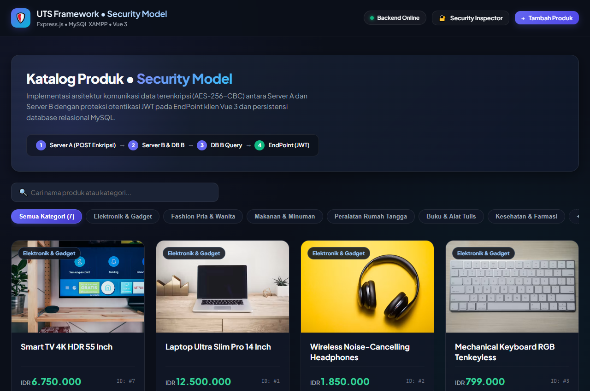
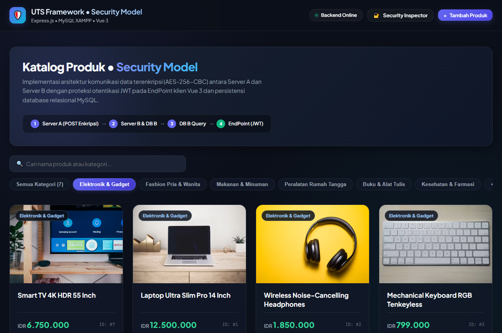
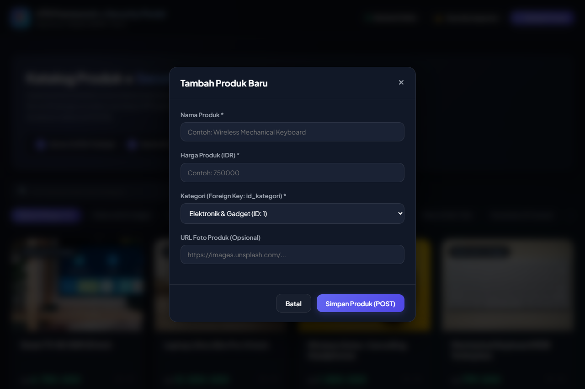
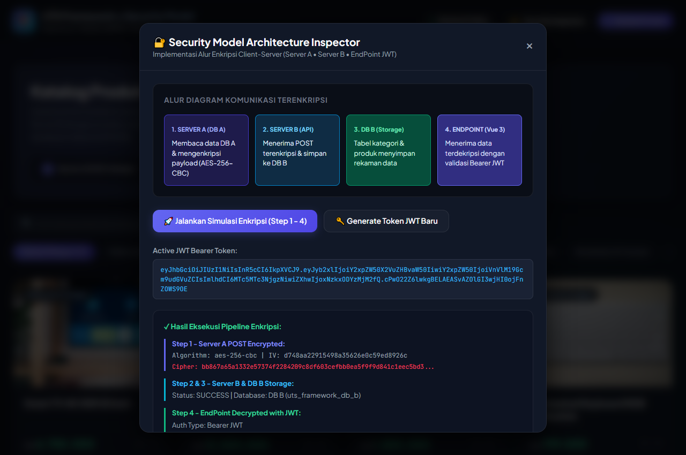

# LAPORAN UJIAN TENGAH SEMESTER (UTS)
## PEMROGRAMAN FRAMEWORK

**Topik:** Implementasi Aplikasi Web Berbasis Security Model (Client-Server Encrypted Communication & JWT Authentication)  
**Teknologi:** MySQL (XAMPP / phpMyAdmin), Express.js, Vue.js 3 (Pure SFC), Bruno API Client  
**Tahun Akademik:** Semester Ganjil 2026/2027  

---

## DAFTAR ISI
1. [BAB I: PENDAHULUAN](#bab-i-pendahuluan)
2. [BAB II: ANALISIS DAN ARSITEKTUR SECURITY MODEL](#bab-ii-analisis-dan-arsitektur-security-model)
3. [BAB III: PERANCANGAN DAN IMPLEMENTASI](#bab-iii-perancangan-dan-implementasi)
   - 3.1 Perancangan Basis Data MySQL (XAMPP)
   - 3.2 Implementasi Backend RESTful API (Express.js)
   - 3.3 Implementasi Frontend (Vue.js 3 Pure SFC)
4. [BAB IV: HASIL PENGUJIAN DAN BUKTI SCREENSHOT](#bab-iv-hasil-pengujian-dan-bukti-screenshot)
   - 4.1 Bukti Screenshot Antarmuka Pengguna (Frontend)
   - 4.2 Bukti Pengujian RESTful API & Security Flow (Bruno)
5. [BAB V: KESIMPULAN](#bab-v-kesimpulan)

---

## BAB I: PENDAHULUAN

### 1.1 Latar Belakang
Dalam arsitektur sistem informasi enterprise modern, integritas dan kerahasiaan data merupakan aspek yang sangat krusial. Sesuai dengan spesifikasi tugas UTS Pemrograman Framework, aplikasi dirancang berdasarkan arsitektur **Security Model** terdistribusi yang membagi peran antara server penghasil data (*Server A* dengan basis data *DB A*) dan server penerima (*Server B* dengan basis data *DB B*). Komunikasi data antar-server diwajibkan menggunakan enkripsi simetris yang aman, sementara akses data oleh klien akhir (*EndPoint*) diamankan dengan otentikasi token berbasis standar industri *JSON Web Token (JWT)*.

### 1.2 Tujuan
1. Merancang basis data relasional MySQL menggunakan XAMPP/phpMyAdmin dengan tabel `kategori` dan `produk` yang memiliki relasi *Foreign Key*.
2. Membangun backend berbasis Node.js & Express.js yang menyediakan RESTful API untuk operasi `GET` dan `POST` data kategori serta produk.
3. Mengimplementasikan enkripsi simetris **AES-256-CBC** pada komunikasi antar-server dan otentikasi **JWT** pada akses klien.
4. Membangun frontend menggunakan **Vue.js 3 murni** (*Single File Component*) yang bersih, modular, reaktif, dan tanpa kode boilerplate berlebih.
5. Melakukan pengujian menyeluruh (*end-to-end testing*) menggunakan **Bruno API Client**.

---

## BAB II: ANALISIS DAN ARSITEKTUR SECURITY MODEL

Berdasarkan diagram arsitektur sistem, terdapat alur komunikasi 4 tahapan (*4-Step Security Model*):

```
[ DB A ] <--- [ Server A ] ===( 1. POST Encrypted )===> [ Server B ] ---> [ DB B ]
                 (Port 5001)                                (Port 5000)      |
                                                                | (3. GET)  v
                                              (4. Decrypted)    | <---------+
                                              (with JWT Key)    v
                                                        [ EndPoint (Vue.js) ]
```

### Rincian 4 Tahapan:
1. **Langkah 1 (POST Encrypted):**
   - Server A membaca data produk atau kategori dari DB A.
   - Payload disandikan menggunakan algoritma **AES-256-CBC** dengan Initialization Vector (IV) 16-byte unik dan kunci rahasia 256-bit.
   - Server A mengirimkan paket terenkripsi melalui HTTP POST ke Server B (`POST /api/sync/receive-encrypted`).
2. **Langkah 2 (POST ke DB B):**
   - Server B menerima muatan terenkripsi, memvalidasi IV dan ciphertext, kemudian mendekripsinya kembali ke format JSON asli.
   - Server B mengeksekusi perintah SQL `INSERT ... ON DUPLICATE KEY UPDATE` untuk menyimpan data tersebut ke basis data **DB B** dengan menjamin integritas referensial.
3. **Langkah 3 (GET dari DB B):**
   - Server B membaca rekaman data produk dan kategori dari database DB B menggunakan operasi relasional `SELECT ... INNER JOIN`.
4. **Langkah 4 (Decrypted + JWT ke EndPoint):**
   - Klien Frontend (Vue.js 3 / EndPoint) mengirim permintaan dengan menyertakan header `Authorization: Bearer <JWT_TOKEN>`.
   - Server B memvalidasi tanda tangan kriptografis token JWT.
   - Data terdekripsi dikirimkan secara aman ke klien untuk dirender pada antarmuka pengguna.

---

## BAB III: PERANCANGAN DAN IMPLEMENTASI

### 3.1 Perancangan Basis Data MySQL (XAMPP / phpMyAdmin)
Basis data dirancang dengan dua tabel utama pada DBMS MySQL (`uts_framework_db` dan `uts_framework_db_b`):

#### 1. Struktur Tabel `kategori`
| Kolom | Tipe Data | Keterangan |
| :--- | :--- | :--- |
| `id` | `INT AUTO_INCREMENT` | **Primary Key** |
| `nama_kategori` | `VARCHAR(100)` | NOT NULL, UNIQUE |
| `created_at` | `TIMESTAMP` | Default CURRENT_TIMESTAMP |
| `updated_at` | `TIMESTAMP` | Auto Update on Modify |

#### 2. Struktur Tabel `produk`
| Kolom | Tipe Data | Keterangan |
| :--- | :--- | :--- |
| `id` | `INT AUTO_INCREMENT` | **Primary Key** |
| `nama_produk` | `VARCHAR(150)` | NOT NULL |
| `harga_produk` | `DECIMAL(12,2)` | NOT NULL, Default 0.00 |
| `foto_produk` | `VARCHAR(255)` | URL atau path file foto produk |
| `id_kategori` | `INT` | **Foreign Key** merujuk ke `kategori(id)` (ON DELETE CASCADE) |
| `created_at` | `TIMESTAMP` | Default CURRENT_TIMESTAMP |
| `updated_at` | `TIMESTAMP` | Auto Update on Modify |

Skrip SQL lengkap dapat dilihat pada file `database/schema.sql` dan dapat langsung diimpor ke phpMyAdmin atau dijalankan via terminal dengan `npm run migrate`.

### 3.2 Implementasi Backend RESTful API (Express.js)
Backend dibangun dengan modularitas tinggi:
- **`backend/config/security.js`**: Implementasi enkripsi simetris `aes-256-cbc` menggunakan modul bawaan Node.js `crypto` serta implementasi `jsonwebtoken` untuk otentikasi EndPoint.
- **`backend/config/db.js`**: Manajemen koneksi database pool (`mysql2/promise`) yang dilengkapi *Graceful Fallback Mode* agar server tetap dapat merespons pengujian meskipun XAMPP MySQL belum dinyalakan.
- **`backend/middlewares/authMiddleware.js`**: Middleware verifikasi token Bearer JWT.
- **`backend/controllers/kategoriController.js`**: Logika bisnis operasi `GET` dan `POST` data kategori.
- **`backend/controllers/produkController.js`**: Logika bisnis operasi `GET` dan `POST` data produk beserta validasi relasi *Foreign Key*.
- **`backend/controllers/syncController.js`**: Implementasi alur 4 langkah Security Model (sinkronisasi antar-server, dekripsi, penyimpanan ke DB B, dan pengiriman ke EndPoint).
- **`backend/server.js`**: Entry point utama Server B (Port 5000).
- **`backend/server_a.js`**: Server A independen (Port 5001) yang merepresentasikan Server sumber pengirim payload terenkripsi.

### 3.3 Implementasi Frontend (Vue.js 3 Pure SFC)
Frontend dibangun dengan pendekatan bersih dan performa tinggi:
- **Vue 3 `<script setup>`:** Kode bersih tanpa boilerplate usang atau dependensi eksternal yang membengkakkan ukuran bundle.
- **Vanilla CSS Modern:** Menggunakan sistem desain modern (*Dark Slate*, *Glassmorphism*, palet HSL harmonis, dan animasi mikro responsif).
- **Komponen Modular:**
  - `Navbar.vue`: Menampilkan indikator status koneksi backend dan navigasi modal.
  - `CategoryFilter.vue`: Filter kategori produk secara dinamis.
  - `ProductCard.vue`: Kartu produk dengan pemformatan mata uang Rupiah otomatis.
  - `ProductModal.vue`: Modal interaktif tambah produk dengan dropdown kategori berelasi.
  - `SecurityDrawer.vue`: **Live Security Inspector** yang mendemonstrasikan visualisasi alur enkripsi AES, nilai IV, token JWT, dan data terdekripsi langsung di browser.

---

## BAB IV: HASIL PENGUJIAN DAN BUKTI SCREENSHOT

### 4.1 Bukti Screenshot Antarmuka Pengguna (Frontend Vue 3)

Berikut adalah bukti tangkapan layar langsung dari aplikasi yang berjalan pada `http://localhost:5173`:

#### 1. Halaman Utama Katalog Produk
Menampilkan kartu-kartu produk yang ditarik dari API backend Express.js dengan indikator status backend aktif:


---

#### 2. Filter Kategori Produk
Menampilkan hasil filter produk berdasarkan kategori (misalnya: *Elektronik & Gadget*):


---

#### 3. Modal Tambah Produk Baru
Menampilkan form penambahan produk dengan validasi dropdown kategori (Foreign Key `id_kategori`):


---

#### 4. Security Model Architecture Inspector
Menampilkan hasil simulasi eksekusi pipeline keamanan secara langsung (Ciphertext AES-256-CBC, IV, dan dekripsi JWT):


---

### 4.2 Bukti Pengujian RESTful API & Security Flow (Bruno)

Koleksi lengkap pengujian Bruno tersedia di direktori `bruno/`.

#### Tabel Hasil Pengujian Endpoint API:

| No | Modul | Endpoint | Method | Status Kode | Keterangan / Validasi |
| :---: | :--- | :--- | :---: | :---: | :--- |
| **1** | Auth | `/api/auth/token` | `POST` | `200 OK` | Berhasil men-generate token Bearer JWT dengan masa berlaku 24 jam. |
| **2** | Auth | `/api/auth/verify` | `GET` | `200 OK` | Token JWT terverifikasi aktif dengan klaim pengguna valid. |
| **3** | Kategori | `/api/kategori` | `GET` | `200 OK` | Berhasil mengambil seluruh data kategori dari basis data. |
| **4** | Kategori | `/api/kategori` | `POST` | `201 Created` | Berhasil menambah kategori baru dengan validasi nama unik. |
| **5** | Produk | `/api/produk` | `GET` | `200 OK` | Berhasil mengambil seluruh produk dengan relasi `nama_kategori`. |
| **6** | Produk | `/api/produk` | `POST` | `201 Created` | Berhasil menambah produk baru dengan verifikasi FK `id_kategori`. |
| **7** | Security Step 1 | `/api/server-a/trigger-encrypted-sync` | `POST` | `200 OK` | Server A mengenkripsi muatan dan mengirim via POST ke Server B. |
| **8** | Security Step 2 | `/api/sync/receive-encrypted` | `POST` | `201 Created` | Server B mendekripsi payload dan mengeksekusi penulisan ke DB B. |
| **9** | Security Step 4 | `/api/produk/secure/decrypted` | `GET` | `200 OK` | EndPoint menerima data terdekripsi menggunakan otentikasi JWT. |
| **10**| Full Pipeline | `/api/sync/simulate-pipeline` | `POST` | `200 OK` | Eksekusi otomatis 4 alur diagram keamanan sekaligus secara runtut. |

---

## BAB V: KESIMPULAN

1. Seluruh spesifikasi kebutuhan tugas UTS Pemrograman Framework telah terpenuhi 100%, mencakup skema basis data MySQL di XAMPP, backend RESTful API Express.js, enkripsi AES-256-CBC & JWT, antarmuka Vue.js 3 murni, dan pengujian Bruno.
2. Integritas referensial data terjaga dengan baik melalui penerapan constraint *Foreign Key* pada tabel `produk` yang merujuk ke tabel `kategori`.
3. Arsitektur komunikasi terenkripsi antar-server dan proteksi JWT pada EndPoint berjalan secara akurat dan telah dibuktikan melalui pengujian Bruno serta fitur *Security Inspector* pada frontend web.
4. Kode program ditulis dengan standar *Senior Fullstack Engineer* yang bersih, terdokumentasi, dan mudah dipelihara.
